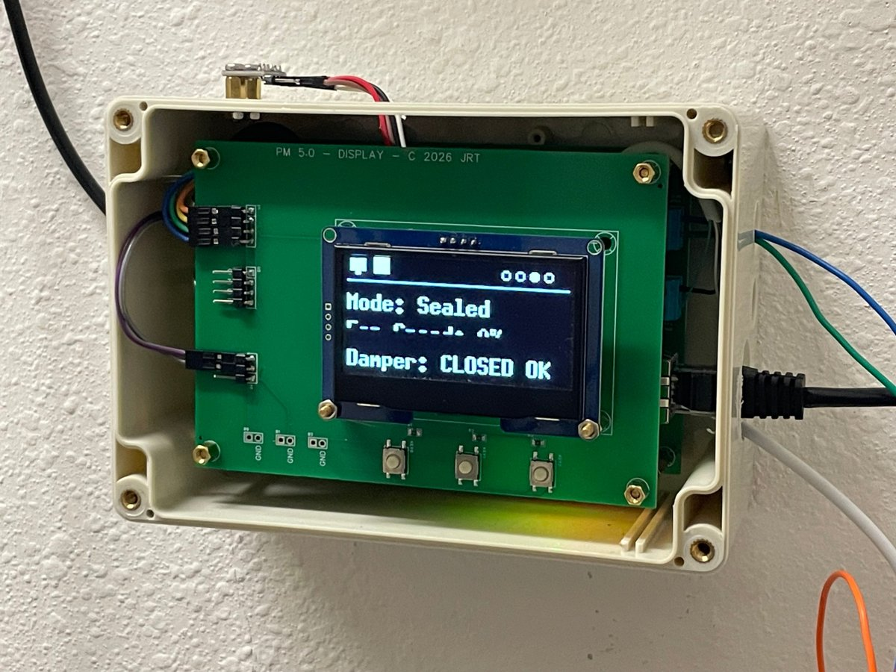
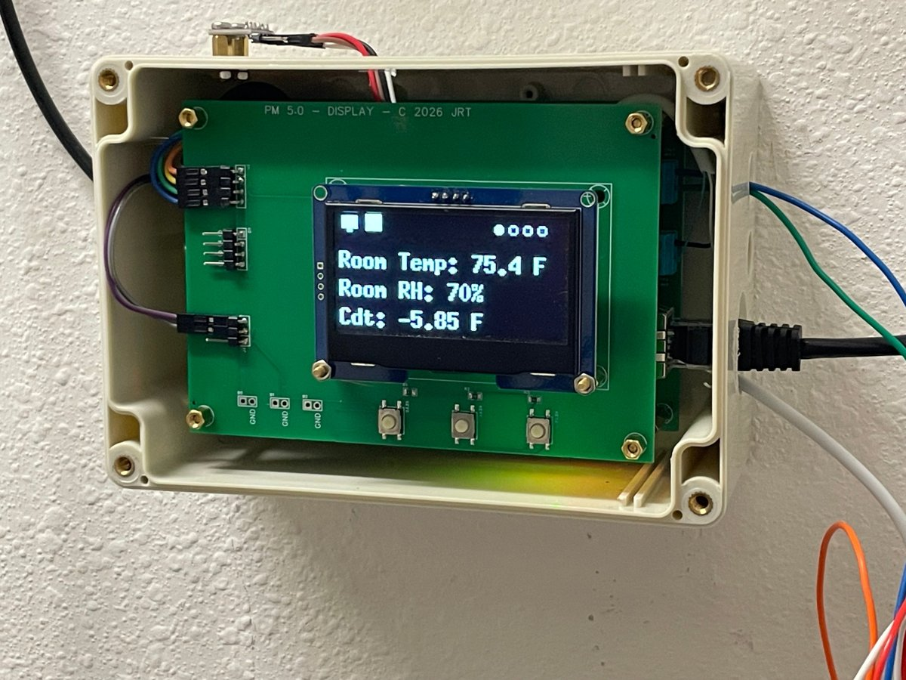
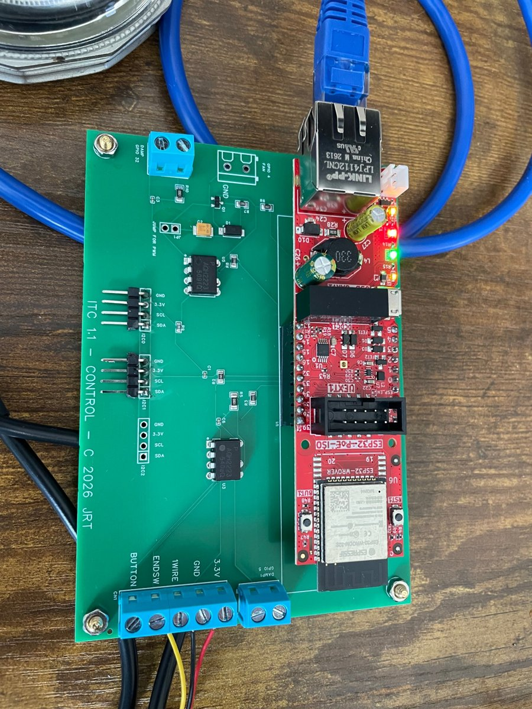
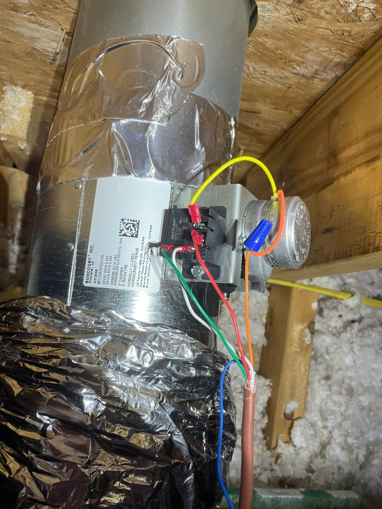
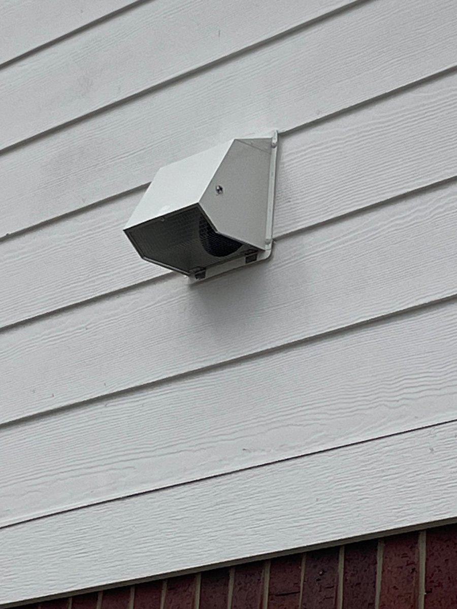

# closet-freecool

An outdoor-air **free-cooling controller for a home IT closet**. When it is
cool enough outside, it opens a motorized damper and modulates an inline fan
to carry the rack's heat out of the closet, so the mini-split doesn't have to.
When it isn't, it seals the closet and stays out of the way.

Built on an Olimex ESP32-POE-ISO (PoE-powered, wired Ethernet) on a custom
carrier board, with an OLED status display, MQTT telemetry and OTA updates.

<p align="center">
  
  
</p>

---

## What it does

- **Free cooling with a heat-balance feedforward.** Fan speed starts from the
  closet's measured heat load and the available closet–outdoor temperature
  difference (Q = 1.08 × CFM × ΔT), then a PI loop trims the remainder. The
  loop starts near the right answer instead of hunting for it.
- **Knows when to give up.** If the fan sits at 100% and still can't hold
  setpoint, the controller seals the closet and locks free cooling out for a
  while, so it doesn't cycle the damper all night. The lockout releases early if
  outdoor temperature falls well below the point where it gave up.
- **Proves airflow.** Once the fan has been running, the exhaust-minus-intake
  temperature rise must show that air is actually moving. A stuck damper or a
  blinded filter puts the controller into Fault rather than letting it believe
  it is cooling.
- **Humidity guard.** It won't bring in outdoor air when the closet RH is high,
  and it drops out of free cooling if RH climbs while it runs.
- **Fails safe.** Every path that isn't the control loop running normally
  ends with the damper closed. Missing or stale sensors seal the closet. Manual
  overrides time out. Faults retry on their own, because the box lives in a
  wall.
- **Observable.** It publishes JSON state over MQTT every 30 s and immediately
  on any change, with a retained online/offline status (LWT), plus a telnet
  console and a four-page OLED display.

## Hardware

| Part | Notes |
|---|---|
| [Olimex ESP32-POE-ISO](https://www.olimex.com/Products/IoT/ESP32/ESP32-POE-ISO/) | Isolated PoE, LAN8720 Ethernet. Use the WROOM version: GPIO16 is taken by PSRAM on the WROVER. |
| Carrier board (`hardware/`) | Fan 0–10 V drive stage, damper SSR, 1-Wire bus, terminal blocks, I²C headers |
| AC Infinity CLOUDLINE A6 | Inline fan with a 0–10 V speed input (sinking) |
| Suncourt ZoneMaster ZC206 | 6" motorized damper, 24 VAC, normally closed |
| Zettler AZ2280 relay | Interposed between the SSR and the damper (see lessons learned) |
| BME280 | Closet temperature and RH, I²C @ 0x76 |
| DS18B20 × 3 | Outdoor (in the intake hood), intake duct, exhaust duct |
| SSD1309 2.42" OLED | 128×64, I²C, on a separate display board with buttons |

<p align="center">
  
  
</p>
<p align="center">
  
</p>

### Pin map

| GPIO | Function |
|---|---|
| 4  | Fan PWM → BSS138 open-drain stage → fan 0–10 V input (inverted: duty 0 = full speed) |
| 13 / 16 | I²C SDA / SCL (BME280, OLED) |
| 33 | DS18B20 1-Wire bus (4.7 k pull-up on the carrier) |
| 32 | Damper SSR (AQH2223) → AZ2280 relay → ZC206 |
| 5  | Second SSR (spare / dehumidifier variant) |
| 34 | BUT1: I²C scan + 1-Wire ROM dump; also wakes the display |
| 36 | BUT2: next display page |

GPIO 12, 17, 18 and 23 belong to the Ethernet PHY. Don't load GPIO12, since
it is also a strapping pin.

### Fan drive and failsafe

The fan's 0–10 V input sources its own voltage, and the controller pulls it
down through an open-drain MOSFET. So **duty 0 means full speed**: if the
controller resets, crashes or loses power, the fan runs flat out. That is the
same thing the fan does with no controller at all.

## Control modes

| Mode | Behaviour |
|---|---|
| **Sealed** | Damper closed, fan off. Enters Freecool when the closet is above setpoint by the deadband, the closet is at least `FREECOOL_DT_MIN` warmer than outdoors, RH is below the guard, no lockout is active, and the minimum dwell has passed. |
| **Freecool** | Damper open, fan modulated by feedforward + PI. Leaves when outdoor air warms (with hysteresis), RH climbs, it is satisfied at minimum fan, or it is out of capacity (which also sets a lockout). |
| **Manual** | Fan and/or damper set over MQTT. Times out back to Sealed after 30 min. |
| **Fault** | Fan off, damper closed. Retries automatically after 10 min. The display stays lit while in Fault. |

All tuning lives at the top of `closet_control.h`: setpoint deadband,
ΔT thresholds, RH limits, PI gains, dwell and timeout values, and the measured
closet load and fan airflow.

## Building and flashing

**Toolchain:** `arduino-cli` with the esp32 core 3.3.x, board
`esp32:esp32:esp32-poe-iso`.

**Libraries:** Adafruit BME280, OneWire, DallasTemperature, PubSubClient,
TelnetStream, U8g2.

1. **Create your site config.** Copy
   `poe_iso_eth_ota/secrets.example.h` to `poe_iso_eth_ota/secrets.h` and fill
   it in: OTA password, MQTT broker, topic prefix, NTP server, time zone and
   the three DS18B20 ROM addresses. `secrets.h` is git-ignored.
2. **Find your probe addresses.** Flash once with the ROMs left at zero, fit
   one probe at a time and press BUT1. The ROM is printed on the serial and
   telnet console, ready to paste.
3. **First flash over USB**, then OTA from then on:
   ```bash
   ./flash.sh            # compile + push to OTA_DEFAULT_IP from secrets.h
   ./flash.sh 10.0.0.42  # or to a specific address
   ./flash.sh -c         # compile only
   ```
   `espota` needs the board to connect back to your machine on TCP 40170, so
   open that port in your host firewall. mDNS doesn't cross VLANs, which is why
   `flash.sh` targets an IP.
4. **Watch it:** `telnet <board-ip>` gives a heartbeat line every 10 s.

## MQTT

Topic prefix is `TOPIC_BASE` from `secrets.h`.

| Topic | Direction | Notes |
|---|---|---|
| `<base>/state` | out | JSON, every 30 s and on any change. **Not retained**, so a stale value can't pass as live. |
| `<base>/status` | out | Retained: `online`, `updating` (during OTA), or the broker-published LWT `offline`. |
| `<base>/cmd/setpoint` | in | °F, 50–100 |
| `<base>/cmd/fan` | in | `0`–`100` (enters Manual) or `auto` |
| `<base>/cmd/damper` | in | `open` / `close` (enters Manual) |
| `<base>/cmd/reboot` | in | `1` or `yes` |

Example `state` payload:

```json
{"ts":"2026-10-28T13:03:29-05:00","closet_t":75.3,"closet_rh":69.5,
 "outdoor_t":81.3,"intake_t":79.2,"exhaust_t":79.5,"duct_dt":0.2,"cdt":-5.96,
 "sat_outdoor":null,"fan_pct":0,"damper":"closed","mode":"Sealed",
 "mode_reason":"","setpoint":77.0,"lockout_s":0,"bme_ok":true,"bme_bad":0,
 "ds_count":3,"ds_bad":0,"uptime":270,"ip":"..."}
```

A missing sensor publishes `null`, never `0.0`, so downstream can tell a zero
reading from an absent probe.

## Commissioning checklist

- [ ] `BENCH_FAST` is `false` (the bench timers would short-cycle the damper)
- [ ] `FAN_BOOT_PCT` is set for service
- [ ] `FAN_FLOOR_PCT` raised to the speed that actually opens the backdraft
      damper through a loaded filter. The bench value is too low.
- [ ] `CLOSET_LOAD_BTUH` and `FAN_MAX_CFM` measured on your install. They drive
      the feedforward.
- [ ] `DAMPER_HAS_ENDSW` matches reality. Without an end switch, damper
      position is assumed after the travel time and the airflow proof is the
      only backstop.
- [ ] Airflow proof checked with the fan running: exhaust should read warmer
      than intake.

## Lessons learned

The problems someone else is most likely to hit:

- **Missing ground between the module header and the carrier.** The rev-A
  schematic never connected the Olimex GND pins to the carrier ground pour. The
  symptoms looked like flaky sensors: intermittent I²C reads that compensated
  to ~358 °F, 2.89 V on the "3.3 V" rail at the sensor, and I²C corruption
  whenever an SSR LED switched. Tie **both** module GND pins.
- **SSR latching on the damper.** Driven directly from the AQH2223 SSR, the
  ZC206 stayed energized after the SSR was told to turn off. The cause was the
  damper's own commutation behaviour, not snubber sizing, and a small
  interposing relay (AZ2280) fixed it.
- **Address 1-Wire probes by ROM, never by bus index.** Enumeration order is
  by ROM value, so adding a probe reshuffles the indices of the existing ones.
- **Probe siting changes what a test can prove.** The first airflow check
  compared the intake to outdoor temperature. The supply duct gains several
  degrees crossing a hot attic, so the intake sat halfway between outdoor and
  closet even at full flow, and the check faulted on good airflow. The closet's
  own exhaust-minus-intake rise has no such dependency.
- **A cache must never gate an output.** An early `damperCommand()` returned
  early when the cached state matched the request. Other paths (MQTT manual,
  OTA start) wrote the pin directly, the cache went stale, and the loop
  silently stopped commanding the damper while every log line said it had.
- **Broker and NTP by IP.** Resolving them through local DNS ties telemetry to
  the DNS server's uptime.

## Repository layout

```
├── flash.sh                     compile + OTA push
├── poe_iso_eth_ota/
│   ├── poe_iso_eth_ota.ino      I/O, sensors, MQTT, display, OTA
│   ├── closet_control.h         the control loop and its tuning
│   └── secrets.example.h        template for your secrets.h
├── hardware/                    carrier schematic, Gerbers, BOM
└── docs/images/
```

## License

Firmware: [MIT](LICENSE). Hardware: [CERN-OHL-P v2](hardware/LICENSE).
